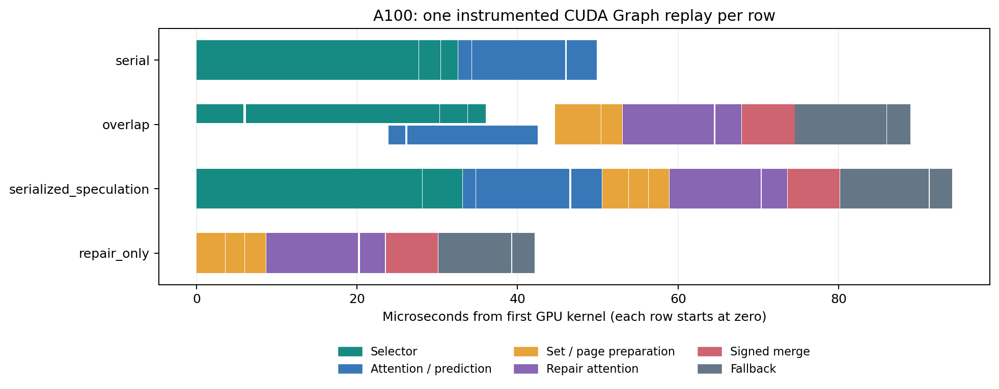

# A100 容器内 profiling

2026-11-09，在固定训练容器的 A100 SXM4 80GB GPU 2 上采集。PyTorch 2.8.0+cu128、Triton 3.4.0、FlashInfer 0.3.1。使用 PyTorch profiler / CUPTI 的真实 CUDA kernel 事件；环境没有可用的 Nsight Systems / Compute。本报告没有 SM 利用率、occupancy、HBM 带宽或 PCIe 硬件计数器。

输入为随机 QSA 形状：8K 上下文，24 Q 头 / 2 KV 头，D=256，4-token 块，K=512。预测 409 块，其中 327 块命中；选择器是独立 QSA 公式加 torch.topk，没有加载原生 QSA 模型。没有 host KV 搬运。

## 无 profiler 的配对计时

先运行 5 对 ABBA、每段 100 次 CUDA Graph 回放。直接串行路径的配对时长中位数为 **59.494 µs**，严格推测路径为 **98.964 µs**，配对比值中位数为 **0.6012×**。此点尚未获得净加速。以下单次插桩时间线用于定位组成，不能代替这组正常计时。

## 单次 Graph 时间线

| 路径 | kernel 数 | kernel 耗时和 µs | 首尾跨度 µs | 无 kernel 区间 µs | 并发区间 µs | 回退头 |
| --- | --- | --- | --- | --- | --- | --- |
| serial | 7 | 49.472 | 49.888 | 0.416 | 0.000 | — |
| overlap | 15 | 97.761 | 88.961 | 2.977 | 11.776 | 2 |
| serialized_speculation | 15 | 92.993 | 94.146 | 1.152 | 0.000 | 2 |
| repair_only | 8 | 41.408 | 42.112 | 0.704 | 0.000 | 2 |
| selector_only | 4 | 31.967 | 32.256 | 0.289 | 0.000 | — |
| prediction_only | 3 | 16.928 | 17.120 | 0.192 | 0.000 | — |

图中每行的零点是该行第一个 GPU kernel。颜色按功能分类，不表示 CUDA stream；overlap 行的选择与预测分别画在上下半行以显示交叠。空白只表示没有记录到 GPU kernel，可能包含依赖等待或其他活动。`serialized_speculation` 和 `overlap` 执行相同计算量。

本次 `overlap` trace 根据 GPU 时间戳实际测得 11.776 µs 的并发区间。Graph 节点跟踪本身会扰动时间线，需要结合下方无 profiler 配对和依赖图诊断；trace lane 的数量本身不是并发证据，也不能据此推断 SM 占用或资源饱和。[NVIDIA 对 Graph 节点跟踪开销的说明](https://docs.nvidia.com/dl-cuda-graph/troubleshooting/performance-issues.html)

## 修复尾部与优化方向

| 独立 repair_only 的组成 | kernel 耗时和 µs |
| --- | --- |
| 分类、压缩、页表 | 8.480 |
| FlashInfer attention 与库内归并 | 14.560 |
| 带符号合并与误差守卫 | 6.496 |
| 保护性重算与归并 | 11.872 |

此点 2/24 个查询头触发数值保护回退。回退占修复 kernel 耗时和的 28.7%。其余准备、库调用和合并仍然显著，所以只缩短擦除或放宽保护条件不足以解释、解决全部差距。

优先级：先确认图调度能覆盖预测，再减少分类/压缩/表构建的启动与中间缓冲；让库 attention 直接产生所需的 FP32 部分状态，减少额外归并及低精度相减引起的回退。后者需要修改、验证内核接口，当前没有实现。保留逐块状态后只归并命中块是另一条无减法路线，应同时计入状态写入成本。单独 selector 中 torch.topk 占主要时间，也值得与原生 QSA selector 对照，不能通过只人为拖慢基线来制造收益。

## 图调度补查

补查在同容器 GPU 2 上进行，导出 Graph DOT 依赖图并对调选择/预测的提交先后。使用同一输入、内核、保护条件，四种输出均通过 FP64 校验。各对照单独进行五对 ABBA/BAAB，因此不同表行不能拼接计算比值。

| 基线 / 候选 | 基线中位 µs | 候选中位 µs | 逐对比值范围 |
| --- | --- | --- | --- |
| serial/selection_first | 59.505 | 94.167 | 0.6317–0.6335 |
| sequential/selection_first | 89.482 | 76.933 | 1.1096–1.1642 |
| selection_first/prediction_first | 76.974 | 79.340 | 0.9687–0.9732 |

`selection_first` 依赖图中选择链 0→1→2→3 与预测链 4→5→6 独立，两者在修复节点 7 汇合，没有选择结束才能开始预测的依赖边。同工作量的无 profiler 配对中，重叠图比顺序图快，与 trace 中观察到的并发一致；不能把全部差异单独归因于并发或未采样的 GPU 时钟。完整路径仍慢于直接串行。调换提交顺序也不是普遍有效的优化，以下原始证据保留所有方向与失败结果。公开 DOT 的非零进程地址已替换为文件内一致的 handle 占位符，节点与边保持不变。

[诊断数据](../results/graph_diagnostic/summary.json) · [选择先提交的依赖图](../results/graph_diagnostic/selection_first.dot) · [预测先提交的依赖图](../results/graph_diagnostic/prediction_first.dot)

## 采样与复现边界

容器内进程列表可能隐藏其他容器的 PID。最终重测另用宿主机查询该 GPU 的进程数，并核对进程属于训练容器；每轮间隔 1 秒，另加查询耗时。[主测审计](../results/profiling/host_gpu_audit.json)和[图诊断审计](../results/graph_diagnostic/host_gpu_audit.json)仅公开计数，不包含用户、PID、主机地址或 UUID。采样未发现共享不等于能够排除采样间隔内的短暂活动。

主测宿主审计在任务选定 GPU 后约 4.1 秒才开始，首个样本已有一个本容器计算进程，因此没有覆盖基线启动初段；不能称为全程隔离证明。所有公开 profiler trace 的时间戳均在对应宿主审计范围内，图诊断审计从启动前开始。

每个路径只采一条单次重放 trace。CPU GraphLaunch API 时长受首次追踪和 profiler 影响，不能当稳态提交开销；摘要中的 DeviceSynchronize 汇总还包含 profiler 退出时的同步。没有据此宣称 CPU、显存或 PCIe 是瓶颈。

[原始摘要](../results/profiling/summary.json) · [串行 trace](../results/profiling/serial.trace.json) · [推测 trace](../results/profiling/overlap.trace.json) · [顺序推测 trace](../results/profiling/serialized_speculation.trace.json) · [修复 trace](../results/profiling/repair_only.trace.json) · [容器执行记录](../results/profiling/run_status.json)

GPU 采集：`python -m experiments.run_container_profile`；调度诊断：追加 `--stage diagnostic`。宿主机另运行 `python -m experiments.host_gpu_audit --gpu <index> --container <name> --output <file>`。报告和图：`python -m benchmarks.summarize_profiling`。
