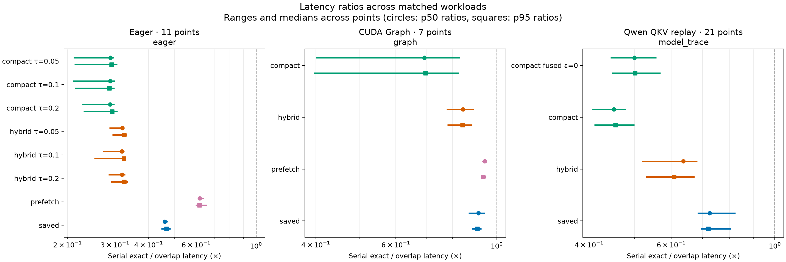
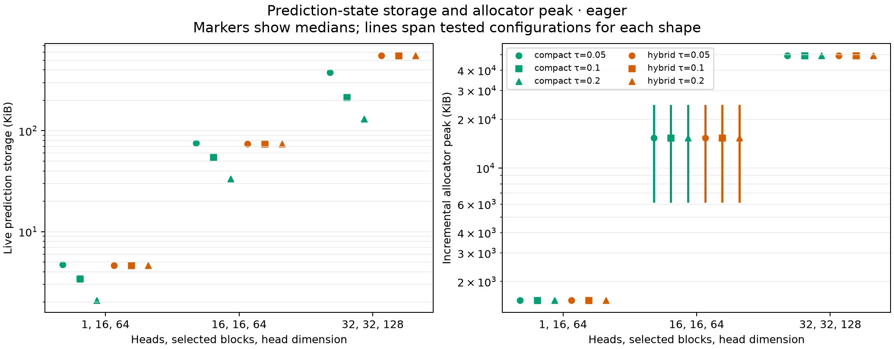
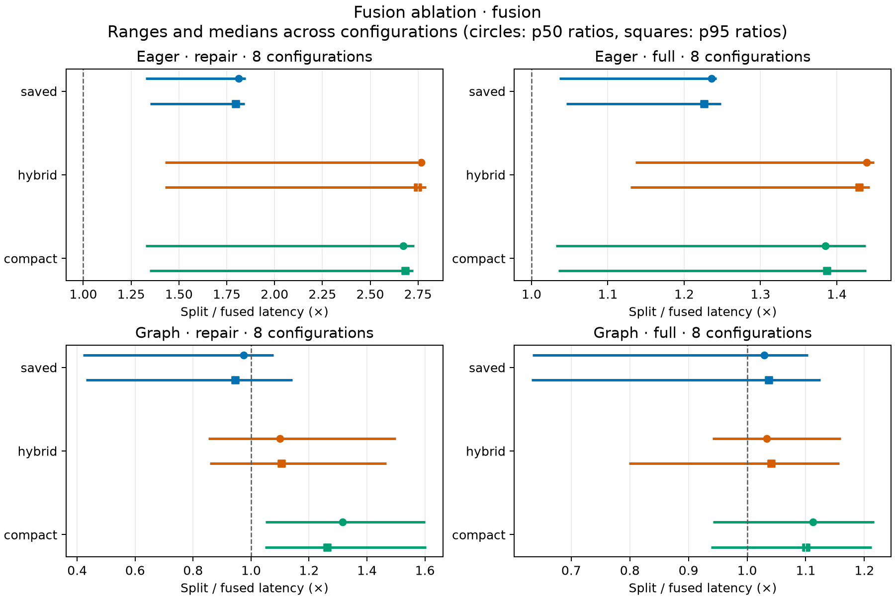
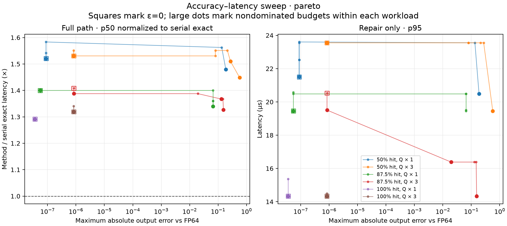

# Strict Top-K 实验结果

串行精确基线先执行块选择，再用同一套 split-block Triton 原型计算所选块注意力。块选择使用预先生成的 K 向量分量最小值和最大值、按 Q 符号取界并执行 `torch.topk`。Eager 的 CUDA event 区间包含主机提交间隙和 CUDA 流等待。CUDA Graph 回放固定输入和块 ID，排除图捕获时间。两类计时均排除编译、块元数据构建与预测 ID 构造。

下表的 p50、p95 来自每测点的全部 CUDA event 样本，p95 采用线性插值。区间表示各测点统计量的最小值到最大值。加速比按同一测点的串行精确基线除以对应方法计算，大于 1 表示对应方法更快。`attention_only` 预先给定所选 ID，仅提供注意力部分的耗时参考。

## 环境

| GPU | CUDA runtime | PyTorch | Triton |
| --- | --- | --- | --- |
| NVIDIA A100-SXM4-80GB | 12.8 | 2.8.0+cu128 | 3.4.0 |

GPU 基准的执行记录与源码摘要见 [run_manifest.json](../results/run_manifest.json)。

## 延迟与内存

### Eager · `eager`

共有 11 个测点，每方法每点 30 次计时，校验状态为通过，捕获失败 0 条。[eager.json](../results/eager.json)

形状按 `(H, N, B, D, K)` 排列。`(1, 2048, 32, 64, 16)`、`(16, 512, 32, 64, 16)`、`(16, 2048, 32, 64, 16)`、`(32, 1024, 64, 128, 32)`。
单独运行 selector 的 p50 为 76.8–175 µs，p95 为 81–177 µs。
逐行 p95/p50 为 1.01–1.27。这些重复样本来自同一基准进程，区间没有跨独立运行估计的置信界。

严格路径相对 FP64 oracle 通过 187/187，最大绝对误差 1.01e-07。

| 方法 | 测点 | p50 (µs) | p95 (µs) | 相对基线 p50 (×) | 相对基线 p95 (×) | p50 快于基线 | 相对同算法串行 p50 (×) |
| --- | --- | --- | --- | --- | --- | --- | --- |
| `serial_exact` | 11 | 193–247 | 201–257 | 1 | 1 | 0/11 | — |
| `attention_only` | 11 | 102–133 | 105–138 | 1.46–2.04 | 1.45–1.97 | 11/11 | — |
| `compact_tau0.05_overlap` | 11 | 668–942 | 680–965 | 0.21–0.297 | 0.212–0.306 | 0/11 | 0.729–0.843 |
| `compact_tau0.05_serial` | 11 | 545–780 | 558–793 | 0.25–0.366 | 0.253–0.365 | 0/11 | — |
| `compact_tau0.1_overlap` | 11 | 664–949 | 677–978 | 0.21–0.299 | 0.213–0.299 | 0/11 | 0.663–0.843 |
| `compact_tau0.1_serial` | 11 | 543–799 | 555–819 | 0.309–0.366 | 0.313–0.376 | 0/11 | — |
| `compact_tau0.2_overlap` | 11 | 664–957 | 679–987 | 0.226–0.299 | 0.229–0.307 | 0/11 | 0.638–0.827 |
| `compact_tau0.2_serial` | 11 | 541–791 | 553–804 | 0.312–0.366 | 0.319–0.375 | 0/11 | — |
| `hybrid_tau0.05_overlap` | 11 | 602–863 | 611–876 | 0.286–0.325 | 0.293–0.331 | 0/11 | 0.794–0.845 |
| `hybrid_tau0.05_serial` | 11 | 493–729 | 504–749 | 0.338–0.403 | 0.343–0.413 | 0/11 | — |
| `hybrid_tau0.1_overlap` | 11 | 605–865 | 621–891 | 0.27–0.325 | 0.251–0.33 | 0/11 | 0.703–0.844 |
| `hybrid_tau0.1_serial` | 11 | 494–731 | 507–750 | 0.338–0.402 | 0.342–0.411 | 0/11 | — |
| `hybrid_tau0.2_overlap` | 11 | 602–870 | 616–886 | 0.284–0.327 | 0.29–0.335 | 0/11 | 0.804–0.846 |
| `hybrid_tau0.2_serial` | 11 | 493–736 | 500–749 | 0.335–0.4 | 0.343–0.404 | 0/11 | — |
| `prefetch_overlap` | 11 | 311–399 | 322–421 | 0.61–0.641 | 0.597–0.658 | 0/11 | — |
| `prr_union_overlap` | 11 | 444–567 | 458–587 | — | — | — | — |
| `saved_overlap` | 11 | 420–541 | 429–567 | 0.455–0.472 | 0.445–0.482 | 0/11 | 0.761–0.803 |
| `saved_serial` | 11 | 326–417 | 335–436 | 0.576–0.606 | 0.578–0.622 | 0/11 | — |

严格推测修复并行路径在 0/77 个方法与测点配对中取得低于串行精确基线的 p50。

并行路径在 0/77 个方法与测点配对中取得低于同算法串行路径的 p50。

| 逐头块重叠率 | 严格并行 p50 加速比 (×) | p50 快于基线 |
| --- | --- | --- |
| 0% | 0.226–0.459 | 0/14 |
| 50% | 0.258–0.472 | 0/21 |
| 87.5% | 0.21–0.461 | 0/28 |
| 100% | 0.289–0.463 | 0/14 |

`prr_union_overlap` 是自实现的并集语义对照。相对并集 FP64 oracle 通过 11/11，相对精确 Top-K 通过 2/11，后者最大绝对误差 0.214。

预测存活状态按底层 tensor storage 去重统计。增量峰值来自 PyTorch allocator，包含计时路径临时 tensor。K、V 块读量按 `H × K` 归一化，是逻辑估算。compact 的统计阶段额外读取一次预测 K。

| 方法 | 预测存活状态 (KiB) | 增量峰值 (KiB) | 逻辑 K 块读 (×) | 逻辑 V 块读 (×) |
| --- | --- | --- | --- | --- |
| `hybrid_tau0.05_overlap` | 4.65–553 | 1.54e+03–4.92e+04 | 1–2.03 | 1–2.03 |
| `hybrid_tau0.1_overlap` | 4.65–553 | 1.54e+03–4.92e+04 | 1–2.03 | 1–2.03 |
| `hybrid_tau0.2_overlap` | 4.65–553 | 1.54e+03–4.92e+04 | 1–2.03 | 1–2.03 |
| `compact_tau0.05_overlap` | 4.71–377 | 1.54e+03–4.92e+04 | 2–3.06 | 1–2.06 |
| `compact_tau0.1_overlap` | 3.4–213 | 1.54e+03–4.92e+04 | 2.06–3.06 | 1.06–2.06 |
| `compact_tau0.2_overlap` | 2.09–132 | 1.54e+03–4.92e+04 | 2–3.06 | 1–2.06 |

同一形状、重叠率与 `τ` 配对时，compact 存活状态是 hybrid 的 23.8–101%，增量峰值是 hybrid 的 100%。compact 每头保留槽数为 `min(S, floor(1/τ) + 1)`，`S` 为预测块数。槽数上限若等于 `S`，额外索引和标记仍占空间。

### CUDA Graph · `graph`

共有 7 个测点，每方法每点 60 次计时，校验状态为通过，捕获失败 0 条。[graph.json](../results/graph.json)

严格路径相对 FP64 oracle 通过 56/56，最大绝对误差 7.01e-08。

| 方法 | 测点 | p50 (µs) | p95 (µs) | 相对基线 p50 (×) | 相对基线 p95 (×) | p50 快于基线 | 相对同算法串行 p50 (×) |
| --- | --- | --- | --- | --- | --- | --- | --- |
| `serial_exact` | 7 | 53.2–186 | 54.3–187 | 1 | 1 | 0/7 | — |
| `compact_overlap` | 7 | 76.8–465 | 77.8–473 | 0.4–0.831 | 0.396–0.825 | 0/7 | 1.11–1.36 |
| `compact_serial` | 7 | 104–517 | 105–524 | 0.36–0.669 | 0.357–0.665 | 0/7 | — |
| `hybrid_overlap` | 7 | 63.5–218 | 64.5–220 | 0.776–0.89 | 0.779–0.883 | 0/7 | 0.992–1.06 |
| `hybrid_serial` | 7 | 66.6–222 | 67.6–231 | 0.732–0.89 | 0.736–0.883 | 0/7 | — |
| `prefetch_overlap` | 7 | 57.3–197 | 58.4–198 | 0.929–0.948 | 0.93–0.948 | 0/7 | — |
| `saved_overlap` | 7 | 58.4–205 | 59.4–207 | 0.867–0.942 | 0.883–0.926 | 0/7 | 0.905–1 |
| `saved_serial` | 7 | 58.4–185 | 59.4–187 | 0.867–1.01 | 0.883–1 | 1/7 | — |

严格推测修复并行路径在 0/21 个方法与测点配对中取得低于串行精确基线的 p50。

并行路径在 11/21 个方法与测点配对中取得低于同算法串行路径的 p50。

| 逐头块重叠率 | 严格并行 p50 加速比 (×) | p50 快于基线 |
| --- | --- | --- |
| 50% | 0.619–0.911 | 0/6 |
| 87.5% | 0.4–0.919 | 0/9 |
| 100% | 0.531–0.942 | 0/6 |

### Qwen QKV 回放 · `model_trace`

共有 21 个测点，每方法每点 20 次计时，校验状态为通过，捕获失败 0 条。[model_trace.json](../results/model_trace.json)

模型为 `Qwen/Qwen3-0.6B-Base`，请求上下文 2048 token，生成 8 步，采样层 [0, 14, 27]。从第二步起用上一解码步的块 ID 预测当前选择。计时使用 graph，每测点固定张量和块 ID。测点的平均逐头重叠率为 78.9%，范围 63.3–90.6%。严格方法逐点回退头数 0，FP64 对照最大绝对误差 3.91e-06。

| 方法 | 测点 | p50 (µs) | p95 (µs) | 相对基线 p50 (×) | 相对基线 p95 (×) | p50 快于基线 | 相对同算法串行 p50 (×) |
| --- | --- | --- | --- | --- | --- | --- | --- |
| `serial_exact` | 21 | 28.7–30.7 | 29.8–33.9 | 1 | 1 | 0/21 | — |
| `compact_fused_eps0` | 21 | 53.2–64.5 | 54.4–67.7 | 0.444–0.558 | 0.448–0.569 | 0/21 | — |
| `compact_overlap` | 21 | 62–70.7 | 62.6–72.9 | 0.406–0.479 | 0.411–0.5 | 0/21 | — |
| `hybrid_overlap` | 21 | 43.5–55.3 | 45.3–56.5 | 0.519–0.682 | 0.529–0.673 | 0/21 | — |
| `saved_overlap` | 21 | 34.8–42 | 39.1–43.1 | 0.683–0.824 | 0.694–0.806 | 0/21 | — |

严格推测修复并行路径在 0/84 个方法与测点配对中取得低于串行精确基线的 p50。

#### Qwen 回放的近似质量预算

同一层、解码步和计时方式配对。严格数值校验与 `ε>0` 的近似误差分开统计。

| ε | 测点 | p50 (µs) | p95 (µs) | 串行精确 / 近似 p50 (×) | p50 快于串行精确 | ε=0 / 近似 p50 (×) | 近似头数 | 最大质量上界 | 最大绝对误差范围 |
| --- | --- | --- | --- | --- | --- | --- | --- | --- | --- |
| 0.01 | 21 | 54.3–65.5 | 54.4–68.6 | 0.438–0.547 | 0/21 | 0.974–1.09 | 1–13 | 0.00995 | 0.000174–0.155 |
| 0.05 | 21 | 51.2–65.5 | 52.3–65.8 | 0.438–0.58 | 0/21 | 0.981–1.1 | 6–16 | 0.0492 | 0.00381–0.214 |
| 0.1 | 21 | 51.2–65.5 | 52.4–66.7 | 0.438–0.58 | 0/21 | 0.966–1.1 | 10–16 | 0.0998 | 0.00969–0.214 |
| 0.2 | 21 | 51.2–62 | 52.4–63.6 | 0.463–0.58 | 0/21 | 0.942–1.1 | 10–16 | 0.187 | 0.0117–0.335 |

Qwen 回放的近似完整路径在 0/84 个配对中快于串行精确。相对 `ε=0` 的 p50 比为 0.942–1.1×。

### 修复融合 · `fusion`

完整路径计时包含 selector、推测、流汇合和修复，修复单测直接复用已选 ID 和预测状态。按同一执行模式、阶段、配置与预测方法配对。`split / fused` 大于 1 表示融合路径更快。[fusion.json](../results/fusion.json)

融合正确性套件通过 304/304，最大绝对误差 1.59e-07。

计时输出相对 FP64 oracle 通过 208/208，每行 60 次计时。

完整路径的各方法及其串行精确基线共用 Triton 融合 min/max 打分与 `torch.topk`。

异质重叠配置的一半头重叠 0%，另一半头重叠 100%。

CUDA Graph 的 compact 修复阶段，融合前后 p95 比为 1.05–1.6×，融合在 8/8 个配置缩短尾部延迟。

#### eager · 修复

| 方法 | 配置 | split p50 (µs) | split p95 (µs) | fused p50 (µs) | fused p95 (µs) | split / fused p50 (×) | split / fused p95 (×) | 串行精确 / fused p50 (×) |
| --- | --- | --- | --- | --- | --- | --- | --- | --- |
| `saved` | 8 | 173–175 | 176–182 | 94.2–132 | 98.4–135 | 1.33–1.85 | 1.35–1.84 | — |
| `hybrid` | 8 | 278–389 | 286–396 | 100–272 | 102–278 | 1.43–2.79 | 1.43–2.79 | — |
| `compact` | 8 | 276–371 | 283–382 | 102–280 | 106–284 | 1.33–2.73 | 1.35–2.72 | — |

#### eager · 完整路径

| 方法 | 配置 | split p50 (µs) | split p95 (µs) | fused p50 (µs) | fused p95 (µs) | split / fused p50 (×) | split / fused p95 (×) | 串行精确 / fused p50 (×) |
| --- | --- | --- | --- | --- | --- | --- | --- | --- |
| `serial_exact` | 8 | 178–181 | 184–193 | — | — | — | — | — |
| `saved` | 8 | 403–411 | 417–428 | 327–393 | 338–404 | 1.04–1.24 | 1.05–1.25 | 0.458–0.555 |
| `hybrid` | 8 | 588–676 | 605–688 | 410–595 | 422–609 | 1.14–1.45 | 1.13–1.44 | 0.303–0.442 |
| `compact` | 8 | 648–731 | 665–745 | 466–709 | 478–720 | 1.03–1.44 | 1.04–1.44 | 0.254–0.389 |

#### graph · 修复

| 方法 | 配置 | split p50 (µs) | split p95 (µs) | fused p50 (µs) | fused p95 (µs) | split / fused p50 (×) | split / fused p95 (×) | 串行精确 / fused p50 (×) |
| --- | --- | --- | --- | --- | --- | --- | --- | --- |
| `saved` | 8 | 13.3–24.6 | 14.3–25.6 | 13.3–58.4 | 13.3–59.4 | 0.421–1.08 | 0.431–1.14 | — |
| `hybrid` | 8 | 17.4–182 | 18.4–195 | 13.3–194 | 13.3–195 | 0.853–1.5 | 0.859–1.47 | — |
| `compact` | 8 | 19.5–222 | 19.5–224 | 13.3–202 | 14.3–203 | 1.05–1.6 | 1.05–1.6 | — |

#### graph · 完整路径

| 方法 | 配置 | split p50 (µs) | split p95 (µs) | fused p50 (µs) | fused p95 (µs) | split / fused p50 (×) | split / fused p95 (×) | 串行精确 / fused p50 (×) |
| --- | --- | --- | --- | --- | --- | --- | --- | --- |
| `serial_exact` | 8 | 49.2–85 | 50.2–86.1 | — | — | — | — | — |
| `saved` | 8 | 54.3–99.3 | 55.3–100 | 49.2–157 | 49.2–159 | 0.634–1.1 | 0.632–1.12 | 0.542–1.14 |
| `hybrid` | 8 | 52.2–229 | 52.2–231 | 51.2–244 | 52.2–290 | 0.941–1.16 | 0.799–1.16 | 0.349–1.09 |
| `compact` | 8 | 72.7–418 | 72.8–421 | 61.4–443 | 62.5–449 | 0.942–1.22 | 0.938–1.21 | 0.192–0.8 |

eager 完整路径中，融合方法有 0/24 个方法与配置配对的 p50 快于同选择器的串行精确基线。

graph 完整路径中，融合方法有 2/24 个方法与配置配对的 p50 快于同选择器的串行精确基线。

- `hybrid_fused`，H=32、B=64、D=128、K=32、块重叠 100%，1.09×。
- `saved_fused`，H=32、B=64、D=128、K=32、块重叠 100%，1.14×。

### 允许额外注意力质量时的精度与延迟 · `pareto`

固定形状的 CUDA Graph 使用 compact 推测及融合修复。`ε` 限制可留在输出中的错误块概率质量，`ε=0` 使用严格路径。质量上界按实现记录的逐头 `extra_mass_bound` 汇总，输出误差则以精确所选集合的 FP64 oracle 实测。两者量纲不同。[pareto.json](../results/pareto.json)

严格精度检查通过，质量预算检查通过。合成实验另外用 FP64 在所选块和保留错误块的并集上独立重算错误质量。每条记录 60 次计时。

| 阶段 | ε | 配置 | p50 (µs) | p95 (µs) | 串行精确 / 该方法 p50 (×) | 近似头数 | 最大质量上界 | FP64 最大错误质量 | 最大绝对误差范围 | 回退头数总和 |
| --- | --- | --- | --- | --- | --- | --- | --- | --- | --- | --- |
| 完整 | 0 | 6 | 63.5–76.8 | 64.5–78 | 0.653–0.774 | — | — | 0 | 6.01e-08–8.42e-07 | 0 |
| 完整 | 0.001 | 6 | 63.5–77.8 | 64.5–77.9 | 0.645–0.774 | 0 | 0 | 0 | 6.01e-08–8.42e-07 | 0 |
| 完整 | 0.01 | 6 | 63.5–76.8 | 64.5–78.8 | 0.653–0.774 | 0–4 | 0.00867 | 0.00801 | 6.01e-08–0.0195 | 0 |
| 完整 | 0.05 | 6 | 63.5–76.8 | 63.5–78.8 | 0.653–0.774 | 0–11 | 0.0495 | 0.0441 | 6.01e-08–0.13 | 0 |
| 完整 | 0.1 | 6 | 63.5–77.8 | 64.5–78.1 | 0.645–0.774 | 0–15 | 0.0989 | 0.0871 | 6.01e-08–0.148 | 0 |
| 完整 | 0.2 | 6 | 63.5–77.8 | 64.5–78.8 | 0.632–0.774 | 0–16 | 0.161 | 0.129 | 6.01e-08–0.212 | 0 |
| 完整 | 0.5 | 6 | 63.5–76.8 | 64.5–77.9 | 0.64–0.774 | 0–16 | 0.49 | 0.308 | 6.01e-08–0.273 | 0 |
| 完整 | 1 | 6 | 63.5–72.7 | 64.5–73.7 | 0.676–0.774 | 0–16 | 0.615 | 0.368 | 6.01e-08–0.57 | 0 |
| 修复 | 0 | 6 | 13.3–22.5 | 14.3–23.6 | — | — | — | 0 | 6.01e-08–8.42e-07 | 0 |
| 修复 | 0.001 | 6 | 13.3–22.5 | 14.3–23.6 | — | 0 | 0 | 0 | 6.01e-08–8.42e-07 | 0 |
| 修复 | 0.01 | 6 | 13.3–23 | 14.3–23.6 | — | 0–4 | 0.00867 | 0.00801 | 6.01e-08–0.0195 | 0 |
| 修复 | 0.05 | 6 | 13.3–23.6 | 14.3–23.6 | — | 0–11 | 0.0495 | 0.0441 | 6.01e-08–0.13 | 0 |
| 修复 | 0.1 | 6 | 13.3–22.5 | 14.3–23.6 | — | 0–15 | 0.0989 | 0.0871 | 6.01e-08–0.148 | 0 |
| 修复 | 0.2 | 6 | 13.3–22.5 | 14.3–23.6 | — | 0–16 | 0.161 | 0.129 | 6.01e-08–0.212 | 0 |
| 修复 | 0.5 | 6 | 13.3–22.5 | 14.3–23.6 | — | 0–16 | 0.49 | 0.308 | 6.01e-08–0.273 | 0 |
| 修复 | 1 | 6 | 13.3–19.5 | 14.3–20.5 | — | 0–16 | 0.615 | 0.368 | 6.01e-08–0.57 | 0 |

在 `ε>0` 的完整路径中，0/42 个配置与预算配对的 p50 快于串行精确基线。相对同配置 `ε=0`，p50 加速比为 0.961–1.06×。

## 数值与回退

### 数值正确性 · `correctness`

Oracle 对相同的量化 Q/K/V 和精确选择的块 ID 使用 FP64。通过条件逐元素为 `|error| ≤ 3e-4 + 3e-4 × |reference|`，同时要求输出有限。覆盖一般随机输入、非二次幂形状、不同大小和无序块集合，以及 6 个对抗案例。[correctness.json](../results/correctness.json)

| 方法 | 输入精度 | 通过 | 最大绝对误差 | 最大逐头相对 L2 | 回退头数总和 |
| --- | --- | --- | --- | --- | --- |
| compact | bfloat16 | 57/57 | 1.1e-07 | 2.65e-07 | 15 |
| compact | float16 | 57/57 | 1.37e-07 | 3.11e-07 | 13 |
| exact | bfloat16 | 19/19 | 9.24e-08 | 2.19e-07 | 0 |
| exact | float16 | 19/19 | 1.37e-07 | 2.45e-07 | 0 |
| hybrid | bfloat16 | 57/57 | 1.06e-07 | 2.88e-07 | 13 |
| hybrid | float16 | 57/57 | 1.37e-07 | 2.88e-07 | 13 |
| saved | bfloat16 | 19/19 | 9.24e-08 | 2.13e-07 | 0 |
| saved | float16 | 19/19 | 1.01e-07 | 2.19e-07 | 0 |

### 数值守卫消融

共有 144 条记录，FP16 对抗案例与质量阈值 `τ` 的组合在不同守卫参数下测试。计时仅包括修复阶段。剩余质量和消去容差均为零时，非有限值等硬条件仍可触发回退。[guard_ablation.json](../results/guard_ablation.json)

消去守卫逐坐标比较相减残差与数值尺度。尺度计入低质量组的绝对分子包络，用于识别组内累加已经发生的消去。触发守卫的头重新计算精确选择集合上的注意力。

| 剩余质量下限 | 消去容差 | 失败 | 回退头数总和 | p50 (µs) | p95 (µs) |
| --- | --- | --- | --- | --- | --- |
| 0 | 0 | 4/18 | 4 | 278–378 | 283–3.26e+03 |
| 0 | 1e-05 | 0/18 | 13 | 278–385 | 285–401 |
| 1e-05 | 0 | 2/18 | 8 | 280–387 | 285–410 |
| 1e-05 | 1e-05 | 0/18 | 13 | 279–382 | 287–421 |
| 0.001 | 0 | 2/18 | 8 | 279–381 | 285–420 |
| 0.001 | 1e-05 | 0/18 | 13 | 280–396 | 286–594 |
| 0.1 | 0 | 2/18 | 8 | 280–377 | 284–498 |
| 0.1 | 1e-05 | 0/18 | 13 | 280–389 | 284–529 |

出现失败的案例包括 `many_low_wrong_mass`、`signed_value_cancellation`。

## 结论边界

合成实验使用受控重叠率、随机 Q/K/V 和单卡固定形状。回放使用真实密集解码的 Q/K/V、完整 32-token 块与扩展的 GQA KV。证据适用于这套原型的选择与注意力阶段。实际 HBM/L2 流量、与厂商优化内核的相对性能、完整模型吞吐及生成质量均需相应实验。

可用 `python -m benchmarks.summarize` 重新生成本文和图表，需安装 matplotlib。
