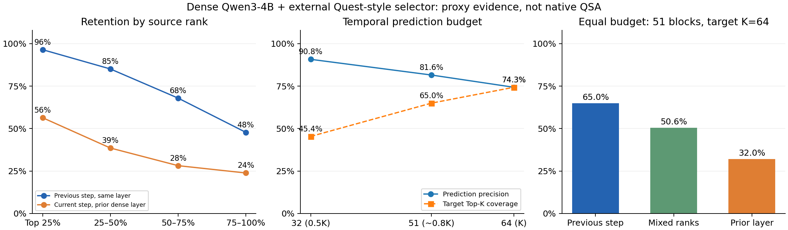

# 选择窗口、推测预算与排名代理实验

目标工作负载是 FlashNext 的 QSA。本轮没有加载其权重，而以 FP16 随机张量、目标形状和独立 Triton 打分构造 `qsa_shape`。打分对每个 indexer 头的 QK 点积取 ReLU，再求和并按头维度缩放，由 `torch.topk` 输出各查询头共享的块 ID。实验范围限于形状、评分代理和内核计时，不是原生 SGLang QSA 或真实模型运行。`current` 是前轮 Quest 风格逐头 min/max 界选择器。

仅在原始选择耗时短于注意力时增加 GPU 算术，目标为 `S:A ≈ 1:1`。填充工作对串行与并行路径都计时。1 CTA 和 64 CTA 是两种合成争用条件。原始 `S ≥ A` 的配置使用自然窗口。完整路径包括选择、推测、流汇合与严格修复。FlashInfer 基线适配为每查询头一个虚拟请求，GPU 页表更新计时，固定规划在计时之外。

合成实验独立控制预算和精确率。关于排名前缀稳定性，证据来自密集 Qwen3-4B Q/K 上的外接 Quest 风格排序。跨层按头序号对齐，结论适用于这一代理。权重训练、QSA 原生服务和生成质量均在本次测量范围之外。

形状参考公开的查询头、KV 头、头维度与 indexer 压缩率。[FlashNext 公开配置](https://huggingface.co/RadixArk/Qwen3.8-Flash-Next-NVFP4/raw/main/config.json)

## 串行阶段探测

`S` 是选择，`A` 是已给定选中 ID 的串行注意力。阶段各自捕获 Graph，并打乱采样顺序。`S/A` 先逐轮求比再取中位数。串行总耗时来自同时包含两阶段的独立 Graph。[current_probe.json](../results/window/current_probe.json) · [qsa_formula_probe.json](../results/window/qsa_formula_probe.json) · [qsa_old_probe.json](../results/window/qsa_old_probe.json)

| 形状 | 上下文 token | K | 注意力实现 | S p50 (µs) | A p50 (µs) | 串行 p50 (µs) | S/A (×) |
| --- | --- | --- | --- | --- | --- | --- | --- |
| current | 16384 | 64 | 分块 | 28.06 | 24.23 | 51.36 | 1.158 |
| current | 32768 | 64 | 分块 | 34.17 | 19.85 | 53.87 | 1.721 |
| current | 16384 | 128 | 分块 | 23.73 | 31.92 | 57.08 | 0.7432 |
| current | 16384 | 256 | 分块 | 23.72 | 59.66 | 83.23 | 0.3975 |
| qsa_shape | 8192 | 512 | 分层 | 31.98 | 25.98 | 57.25 | 1.231 |
| qsa_shape | 32768 | 512 | 分层 | 74.15 | 25.95 | 99.09 | 2.858 |
| qsa_shape | 8192 | 512 | 分块 | 31.98 | 425.2 | 458.1 | 0.0752 |
| qsa_shape | 32768 | 512 | 分块 | 74.17 | 425.9 | 497.1 | 0.1741 |

## 控制选择窗口与预测预算

设备为 NVIDIA A100-SXM4-80GB，种子为 20261103、20261104、20261105，共 90 个测点，计时后 Graph 输出校验 360/360。完整注意力与 FP64 比较，无修复对照只校验选中 ID。[simulation_20261103.json](../results/window/simulation_20261103.json) · [simulation_20261104.json](../results/window/simulation_20261104.json) · [simulation_20261105.json](../results/window/simulation_20261105.json)

| 形状 | 查询头 | KV 头 | 头维度 | 块长 token |
| --- | --- | --- | --- | --- |
| current | 16 | 8 | 128 | 32 |
| qsa_shape | 24 | 2 | 256 | 4 |

### 选择窗口校准

当原始 `S < A` 时才增加一段 GPU 算术，并复测 `S/A`。`S ≥ A` 保留原始路径。1 CTA 与 64 CTA 两种填充只检验合成工作并行占用的影响。表中横线表示该列无独立填充复测。

| 形状 | 上下文 token | K | 窗口 | 自然 S/A (×) | 校准后 S/A (×) | 实际填充种子 | 迭代次数 |
| --- | --- | --- | --- | --- | --- | --- | --- |
| current | 16384 | 128 | natural | 0.7385–0.7545 | — | 0/3 | — |
| current | 16384 | 128 | pad_1_ctas | 0.7385–0.7545 | 0.9984–1.001 | 3/3 | 1416–1544 |
| current | 16384 | 128 | pad_64_ctas | 0.7385–0.7545 | 0.9973–1.005 | 3/3 | 1344–1496 |
| qsa_shape | 8192 | 512 | natural | 1.233–1.251 | — | 0/3 | — |
| qsa_shape | 8192 | 512 | pad_1_ctas | 1.233–1.251 | — | 0/3 | — |
| qsa_shape | 8192 | 512 | pad_64_ctas | 1.233–1.251 | — | 0/3 | — |
| qsa_shape | 32768 | 512 | natural | 2.562–2.844 | — | 0/3 | — |
| qsa_shape | 32768 | 512 | pad_1_ctas | 2.562–2.844 | — | 0/3 | — |
| qsa_shape | 32768 | 512 | pad_64_ctas | 2.562–2.844 | — | 0/3 | — |

`current` 的完整严格推测路径相对同实现串行的比值为 0.8404–1.019×，8/54 个测点较快。相对适配的 FlashInfer 串行为 0.6582–0.8281×，0/54 个测点较快。

`qsa_shape` 的完整严格推测路径相对同实现串行的比值为 0.8398–0.9459×，0/36 个测点较快。相对适配的 FlashInfer 串行为 0.7893–0.9121×，0/36 个测点较快。

在校准到约 1:1 且有漏块的测点，完整路径相对同实现串行的比值为 0.8501–0.968×，较快测点为 0/30。

### 按窗口汇总配对耗时

ABBA/BAAB 每段为 Graph 多次回放的均摊耗时。同一对的两段基线均值除以两段候选均值，逐测点报告比值中位数。大于 1 表示候选更快。`zero_repair_overlap` 只返回选中 ID 和推测状态。

| 形状 | 上下文 token | K | 窗口 | 分子 / 分母 | 测点比值范围 (×) | 中位数 >1 | 全部配对 >1 | 配对基线减候选 (µs) |
| --- | --- | --- | --- | --- | --- | --- | --- | --- |
| current | 16384 | 128 | natural | `serial_exact` / `saved_overlap` | 0.8404–1.019 | 3/18 | 2/18 | -10.87–1.091 |
| current | 16384 | 128 | natural | `serial_flashinfer` / `saved_overlap` | 0.6582–0.8063 | 0/18 | 0/18 | -23.17–-10.85 |
| current | 16384 | 128 | natural | `serial_exact` / `zero_repair_overlap` | 1.192–1.671 | 18/18 | 18/18 | 9.093–22.83 |
| current | 16384 | 128 | natural | `serial_exact` / `serial_flashinfer` | 1.255–1.275 | 18/18 | 18/18 | 11.47–12.46 |
| current | 16384 | 128 | pad_1_ctas | `serial_exact` / `saved_overlap` | 0.8515–1.007 | 2/18 | 1/18 | -11.43–0.4557 |
| current | 16384 | 128 | pad_1_ctas | `serial_flashinfer` / `saved_overlap` | 0.6938–0.8196 | 0/18 | 0/18 | -23.45–-11.78 |
| current | 16384 | 128 | pad_1_ctas | `serial_exact` / `zero_repair_overlap` | 1.163–1.561 | 18/18 | 18/18 | 9.155–23.72 |
| current | 16384 | 128 | pad_1_ctas | `serial_exact` / `serial_flashinfer` | 1.215–1.236 | 18/18 | 18/18 | 11.58–12.51 |
| current | 16384 | 128 | pad_64_ctas | `serial_exact` / `saved_overlap` | 0.8501–1.01 | 3/18 | 2/18 | -11.47–0.6605 |
| current | 16384 | 128 | pad_64_ctas | `serial_flashinfer` / `saved_overlap` | 0.6933–0.8281 | 0/18 | 0/18 | -23.47–-11.14 |
| current | 16384 | 128 | pad_64_ctas | `serial_exact` / `zero_repair_overlap` | 1.164–1.562 | 18/18 | 18/18 | 9.201–23.49 |
| current | 16384 | 128 | pad_64_ctas | `serial_exact` / `serial_flashinfer` | 1.218–1.233 | 18/18 | 18/18 | 11.66–12.33 |
| qsa_shape | 8192 | 512 | natural | `serial_exact` / `saved_overlap` | 0.8398–0.9074 | 0/18 | 0/18 | -10.87–-5.837 |
| qsa_shape | 8192 | 512 | natural | `serial_flashinfer` / `saved_overlap` | 0.7893–0.8504 | 0/18 | 0/18 | -14.25–-9.472 |
| qsa_shape | 8192 | 512 | natural | `serial_exact` / `zero_repair_overlap` | 1.393–1.621 | 18/18 | 18/18 | 16.02–22.03 |
| qsa_shape | 8192 | 512 | natural | `serial_exact` / `serial_flashinfer` | 1.055–1.079 | 18/18 | 18/18 | 2.975–4.214 |
| qsa_shape | 32768 | 512 | natural | `serial_exact` / `saved_overlap` | 0.8909–0.9459 | 0/18 | 0/18 | -11.35–-5.693 |
| qsa_shape | 32768 | 512 | natural | `serial_flashinfer` / `saved_overlap` | 0.8503–0.9121 | 0/18 | 0/18 | -15.34–-9.231 |
| qsa_shape | 32768 | 512 | natural | `serial_exact` / `zero_repair_overlap` | 1.195–1.315 | 18/18 | 18/18 | 15.96–22.13 |
| qsa_shape | 32768 | 512 | natural | `serial_exact` / `serial_flashinfer` | 1.035–1.048 | 18/18 | 18/18 | 3.348–4.198 |

### 预算和命中率分层

精确率为命中数 / 预测数，覆盖率为命中数 / 所选 K。按种子在同一形状、窗口、预算和精确率下配对。每个测点的原始记录保留每轮延迟。

| 形状 | 上下文 token | K | 窗口 | 预测数 | 精确率 | 覆盖率 | 漏块/头 | 错块/头 | 同实现比值 (×) | 较快种子 | FlashInfer 比值 (×) | 较快种子 |
| --- | --- | --- | --- | --- | --- | --- | --- | --- | --- | --- | --- | --- |
| current | 16384 | 128 | natural | 64 | 79.7% | 39.8% | 77 | 13 | 0.9104–0.9119 | 0/3 | 0.7167–0.7218 | 0/3 |
| current | 16384 | 128 | natural | 64 | 100% | 50% | 64 | 0 | 0.9569–0.96 | 0/3 | 0.7519–0.7577 | 0/3 |
| current | 16384 | 128 | natural | 102 | 80.4% | 64.1% | 46 | 20 | 0.8644–0.8722 | 0/3 | 0.6817–0.684 | 0/3 |
| current | 16384 | 128 | natural | 102 | 100% | 79.7% | 26 | 0 | 0.9183–0.9212 | 0/3 | 0.7236–0.7277 | 0/3 |
| current | 16384 | 128 | natural | 128 | 79.7% | 79.7% | 26 | 26 | 0.8404–0.8511 | 0/3 | 0.6582–0.6712 | 0/3 |
| current | 16384 | 128 | natural | 128 | 100% | 100% | 0 | 0 | 1.004–1.019 | 3/3 | 0.7977–0.8063 | 0/3 |
| current | 16384 | 128 | pad_1_ctas | 64 | 79.7% | 39.8% | 77 | 13 | 0.9124–0.9191 | 0/3 | 0.7402–0.7455 | 0/3 |
| current | 16384 | 128 | pad_1_ctas | 64 | 100% | 50% | 64 | 0 | 0.9535–0.968 | 0/3 | 0.7775–0.788 | 0/3 |
| current | 16384 | 128 | pad_1_ctas | 102 | 80.4% | 64.1% | 46 | 20 | 0.863–0.867 | 0/3 | 0.7059–0.7138 | 0/3 |
| current | 16384 | 128 | pad_1_ctas | 102 | 100% | 79.7% | 26 | 0 | 0.9263–0.9326 | 0/3 | 0.7511–0.7689 | 0/3 |
| current | 16384 | 128 | pad_1_ctas | 128 | 79.7% | 79.7% | 26 | 26 | 0.8515–0.853 | 0/3 | 0.6938–0.7006 | 0/3 |
| current | 16384 | 128 | pad_1_ctas | 128 | 100% | 100% | 0 | 0 | 0.9999–1.007 | 2/3 | 0.812–0.8196 | 0/3 |
| current | 16384 | 128 | pad_64_ctas | 64 | 79.7% | 39.8% | 77 | 13 | 0.9129–0.9294 | 0/3 | 0.745–0.7617 | 0/3 |
| current | 16384 | 128 | pad_64_ctas | 64 | 100% | 50% | 64 | 0 | 0.9483–0.9643 | 0/3 | 0.775–0.7851 | 0/3 |
| current | 16384 | 128 | pad_64_ctas | 102 | 80.4% | 64.1% | 46 | 20 | 0.8728–0.8811 | 0/3 | 0.7088–0.7154 | 0/3 |
| current | 16384 | 128 | pad_64_ctas | 102 | 100% | 79.7% | 26 | 0 | 0.9216–0.9285 | 0/3 | 0.7489–0.756 | 0/3 |
| current | 16384 | 128 | pad_64_ctas | 128 | 79.7% | 79.7% | 26 | 26 | 0.8501–0.8547 | 0/3 | 0.6933–0.6962 | 0/3 |
| current | 16384 | 128 | pad_64_ctas | 128 | 100% | 100% | 0 | 0 | 1.001–1.01 | 3/3 | 0.8202–0.8281 | 0/3 |
| qsa_shape | 8192 | 512 | natural | 256 | 80.1% | 40% | 307 | 51 | 0.8961–0.9074 | 0/3 | 0.8324–0.8421 | 0/3 |
| qsa_shape | 8192 | 512 | natural | 256 | 100% | 50% | 256 | 0 | 0.8912–0.904 | 0/3 | 0.8408–0.8504 | 0/3 |
| qsa_shape | 8192 | 512 | natural | 409 | 80% | 63.9% | 185 | 82 | 0.8528–0.8572 | 0/3 | 0.8041–0.8118 | 0/3 |
| qsa_shape | 8192 | 512 | natural | 409 | 100% | 79.9% | 103 | 0 | 0.8642–0.8753 | 0/3 | 0.8189–0.8224 | 0/3 |
| qsa_shape | 8192 | 512 | natural | 512 | 80.1% | 80.1% | 102 | 102 | 0.8398–0.846 | 0/3 | 0.7893–0.7969 | 0/3 |
| qsa_shape | 8192 | 512 | natural | 512 | 100% | 100% | 0 | 0 | 0.8701–0.8836 | 0/3 | 0.8172–0.8218 | 0/3 |
| qsa_shape | 32768 | 512 | natural | 256 | 80.1% | 40% | 307 | 51 | 0.9289–0.9336 | 0/3 | 0.8859–0.8996 | 0/3 |
| qsa_shape | 32768 | 512 | natural | 256 | 100% | 50% | 256 | 0 | 0.9371–0.9459 | 0/3 | 0.8963–0.9121 | 0/3 |
| qsa_shape | 32768 | 512 | natural | 409 | 80% | 63.9% | 185 | 82 | 0.8909–0.9029 | 0/3 | 0.8503–0.8714 | 0/3 |
| qsa_shape | 32768 | 512 | natural | 409 | 100% | 79.9% | 103 | 0 | 0.9141–0.9189 | 0/3 | 0.8703–0.8854 | 0/3 |
| qsa_shape | 32768 | 512 | natural | 512 | 80.1% | 80.1% | 102 | 102 | 0.8981–0.9062 | 0/3 | 0.8563–0.8712 | 0/3 |
| qsa_shape | 32768 | 512 | natural | 512 | 100% | 100% | 0 | 0 | 0.9164–0.9213 | 0/3 | 0.8767–0.8889 | 0/3 |

## Qwen/Qwen3-4B 的排名轨迹

上下文 [16384, 32768]，密集解码 8 步，采样目标层 [1, 18, 35]，块长 32，K=64。共 126 个预算与快照组合。[predictor_rank_trace.json](../results/window/predictor_rank_trace.json)

`temporal` 取上一解码步同层排名，`layer` 取本步前一密集层排名，`interleave` 依次从两份排名交替取唯一 ID。跨层按同一查询头序号配对。目标块来自本步同层的 Quest 风格代理排名。各步和层的头样本用于描述性统计。轨迹分析的指标为排名和集合命中。

排序按分数降序，完全同分按块 ID 升序。采样排名中有 2/3072 个头的并列跨过 Top-K 截断位置。

下表把采样上下文和层合并作描述性汇总。各头跨层、跨步有重复观测。

| 预测数 | 策略 | 平均精确率 (%) | 平均覆盖率 (%) |
| --- | --- | --- | --- |
| 32 | `temporal` | 90.792 | 45.396 |
| 32 | `layer` | 47.489 | 23.744 |
| 32 | `interleave` | 69.120 | 34.560 |
| 51 | `temporal` | 81.553 | 64.988 |
| 51 | `layer` | 40.163 | 32.005 |
| 51 | `interleave` | 63.450 | 50.562 |
| 64 | `temporal` | 74.336 | 74.336 |
| 64 | `layer` | 36.757 | 36.757 |
| 64 | `interleave` | 59.126 | 59.126 |

| 上下文 token | 预测数 | 策略 | 头样本数 | 平均精确率 (%) | 平均覆盖率 (%) | 漏块范围/头 | 错块范围/头 |
| --- | --- | --- | --- | --- | --- | --- | --- |
| 16384 | 32 | `temporal` | 672 | 89.453 | 44.727 | 32–57 | 0–25 |
| 16384 | 32 | `layer` | 672 | 50.507 | 25.253 | 32–64 | 0–32 |
| 16384 | 32 | `interleave` | 672 | 69.545 | 34.773 | 32–60 | 0–28 |
| 16384 | 51 | `temporal` | 672 | 80.089 | 63.821 | 13–53 | 0–40 |
| 16384 | 51 | `layer` | 672 | 43.035 | 34.294 | 20–63 | 7–50 |
| 16384 | 51 | `interleave` | 672 | 63.874 | 50.900 | 18–57 | 5–44 |
| 16384 | 64 | `temporal` | 672 | 73.098 | 73.098 | 3–52 | 3–52 |
| 16384 | 64 | `layer` | 672 | 39.472 | 39.472 | 13–62 | 13–62 |
| 16384 | 64 | `interleave` | 672 | 59.545 | 59.545 | 10–55 | 10–55 |
| 32768 | 32 | `temporal` | 672 | 92.132 | 46.066 | 32–55 | 0–23 |
| 32768 | 32 | `layer` | 672 | 44.471 | 22.235 | 33–64 | 1–32 |
| 32768 | 32 | `interleave` | 672 | 68.694 | 34.347 | 32–58 | 0–26 |
| 32768 | 51 | `temporal` | 672 | 83.018 | 66.155 | 13–51 | 0–38 |
| 32768 | 51 | `layer` | 672 | 37.290 | 29.715 | 21–64 | 8–51 |
| 32768 | 51 | `interleave` | 672 | 63.025 | 50.223 | 17–56 | 4–43 |
| 32768 | 64 | `temporal` | 672 | 75.574 | 75.574 | 3–50 | 3–50 |
| 32768 | 64 | `layer` | 672 | 34.043 | 34.043 | 16–64 | 16–64 |
| 32768 | 64 | `interleave` | 672 | 58.708 | 58.708 | 9–52 | 9–52 |

### 按上下文和目标层分组

| 上下文 token | 目标层 | 预测数 | 头样本数 | 时间覆盖率 (%) | 前层覆盖率 (%) | 交错覆盖率 (%) |
| --- | --- | --- | --- | --- | --- | --- |
| 16384 | 1 | 32 | 224 | 44.357 | 24.588 | 34.842 |
| 16384 | 1 | 51 | 224 | 63.079 | 33.112 | 50.328 |
| 16384 | 1 | 64 | 224 | 72.503 | 37.807 | 58.670 |
| 16384 | 18 | 32 | 224 | 43.394 | 32.931 | 39.460 |
| 16384 | 18 | 51 | 224 | 61.237 | 42.334 | 55.064 |
| 16384 | 18 | 64 | 224 | 69.950 | 47.656 | 63.170 |
| 16384 | 35 | 32 | 224 | 46.429 | 18.241 | 30.015 |
| 16384 | 35 | 51 | 224 | 67.146 | 27.434 | 47.307 |
| 16384 | 35 | 64 | 224 | 76.842 | 32.952 | 56.794 |
| 32768 | 1 | 32 | 224 | 44.043 | 19.747 | 32.366 |
| 32768 | 1 | 51 | 224 | 62.451 | 28.341 | 48.110 |
| 32768 | 1 | 64 | 224 | 71.429 | 33.650 | 56.494 |
| 32768 | 18 | 32 | 224 | 47.482 | 34.891 | 41.825 |
| 32768 | 18 | 51 | 224 | 68.743 | 42.446 | 57.806 |
| 32768 | 18 | 64 | 224 | 78.460 | 46.289 | 66.148 |
| 32768 | 35 | 32 | 224 | 46.673 | 12.068 | 28.850 |
| 32768 | 35 | 51 | 224 | 67.271 | 18.359 | 44.754 |
| 32768 | 35 | 64 | 224 | 76.835 | 22.189 | 53.481 |

| 上下文 token | 预测数 | 两来源共同命中/头 | 仅时间命中/头 | 仅跨层命中/头 | 交错比时间多命中 | 交错比跨层多命中 |
| --- | --- | --- | --- | --- | --- | --- |
| 16384 | 32 | 11.504 | 17.121 | 4.658 | 58/672 | 646/672 |
| 16384 | 51 | 17.481 | 23.365 | 4.467 | 48/672 | 651/672 |
| 16384 | 64 | 21.219 | 25.564 | 4.043 | 49/672 | 658/672 |
| 32768 | 32 | 10.891 | 18.591 | 3.339 | 21/672 | 656/672 |
| 32768 | 51 | 15.826 | 26.513 | 3.192 | 18/672 | 667/672 |
| 32768 | 64 | 19.013 | 29.354 | 2.774 | 20/672 | 666/672 |

### 排名位置与保留率

四分位统计使用完整 K 预算。`Q1` 是最高分四分位。来源保留率问旧排名中的块能否进入当前 Top-K；目标覆盖率问当前排名中的块是否被旧排名预测到。

| 上下文 token | 策略 | 统计方向 | Q1 (%) | Q2 (%) | Q3 (%) | Q4 (%) |
| --- | --- | --- | --- | --- | --- | --- |
| 16384 | `temporal` | 来源排序被目标保留 | 95.685 | 83.222 | 66.397 | 47.089 |
| 16384 | `temporal` | 目标排序被预测覆盖 | 95.554 | 83.315 | 65.951 | 47.573 |
| 16384 | `layer` | 来源排序被目标保留 | 58.798 | 42.215 | 30.766 | 26.107 |
| 16384 | `layer` | 目标排序被预测覆盖 | 67.820 | 38.467 | 28.906 | 22.693 |
| 16384 | `interleave` | 目标排序被预测覆盖 | 93.797 | 71.205 | 45.312 | 27.865 |
| 32768 | `temporal` | 来源排序被目标保留 | 97.247 | 87.016 | 69.522 | 48.512 |
| 32768 | `temporal` | 目标排序被预测覆盖 | 97.582 | 86.579 | 69.671 | 48.465 |
| 32768 | `layer` | 来源排序被目标保留 | 54.018 | 34.924 | 25.595 | 21.633 |
| 32768 | `layer` | 目标排序被预测覆盖 | 61.337 | 33.901 | 23.103 | 17.829 |
| 32768 | `interleave` | 目标排序被预测覆盖 | 94.410 | 72.898 | 43.369 | 24.154 |

前缀与尾部使用同一来源排名及相同目标 Top-K。前缀为 `floor(0.8K)` 个块。

| 上下文 token | 策略 | 前缀块数 | 尾部块数 | 前缀保留率 (%) | 尾部保留率 (%) | 前缀率较高的头样本 |
| --- | --- | --- | --- | --- | --- | --- |
| 16384 | `layer` | 51 | 13 | 43.035 | 25.492 | 569/672 |
| 16384 | `temporal` | 51 | 13 | 80.089 | 45.673 | 661/672 |
| 32768 | `layer` | 51 | 13 | 37.290 | 21.303 | 525/672 |
| 32768 | `temporal` | 51 | 13 | 83.018 | 46.371 | 662/672 |

## 执行记录

GPU 运行记录与源码摘要见 [run_manifest.json](../results/window/run_manifest.json)。

| 阶段 | 退出码 |
| --- | --- |
| current_probe | 0 |
| qsa_formula_probe | 0 |
| qsa_old_probe | 0 |
| predictor_rank_trace | 0 |
| simulation_20261103 | 0 |
| simulation_20261104 | 0 |
| simulation_20261105 | 0 |

新的打包与分层归并内核另在 FP16、BF16 下通过 36 项 FP64/Graph 变 ID 检查，见 [correctness.json](../results/window/correctness.json)。

运行 `python -m benchmarks.summarize_window` 可从原始 JSON 重新生成此文。
